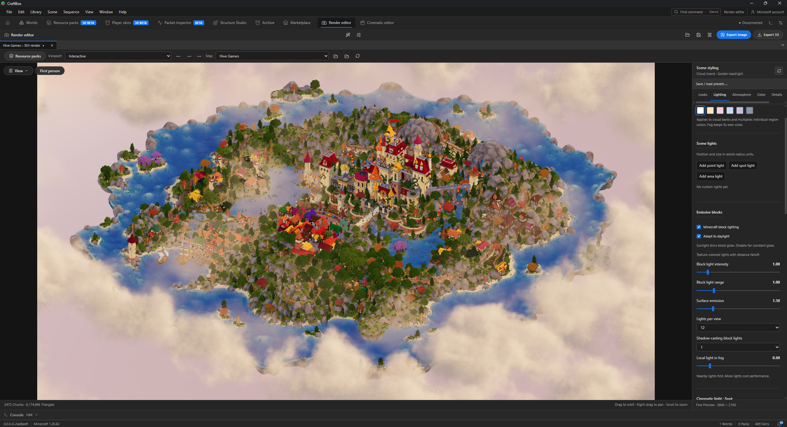
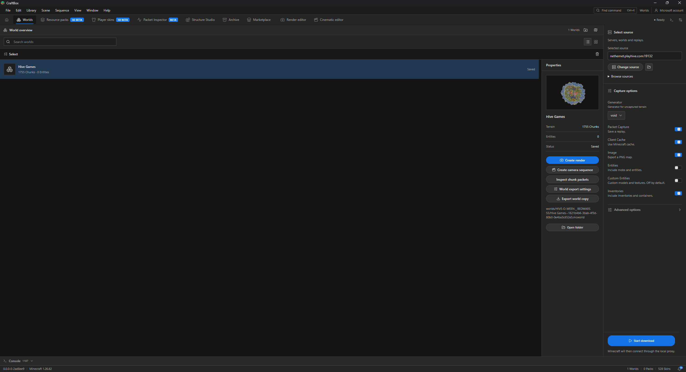
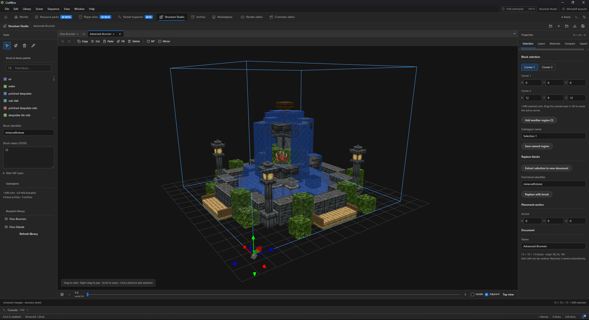
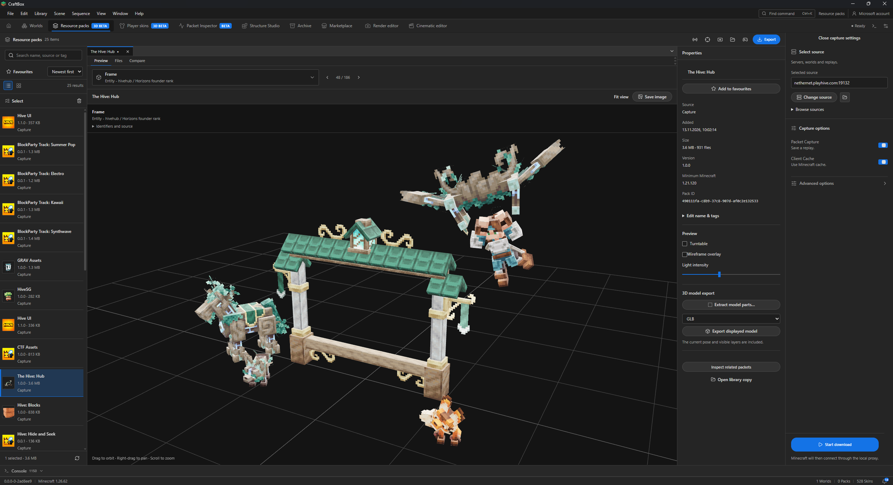
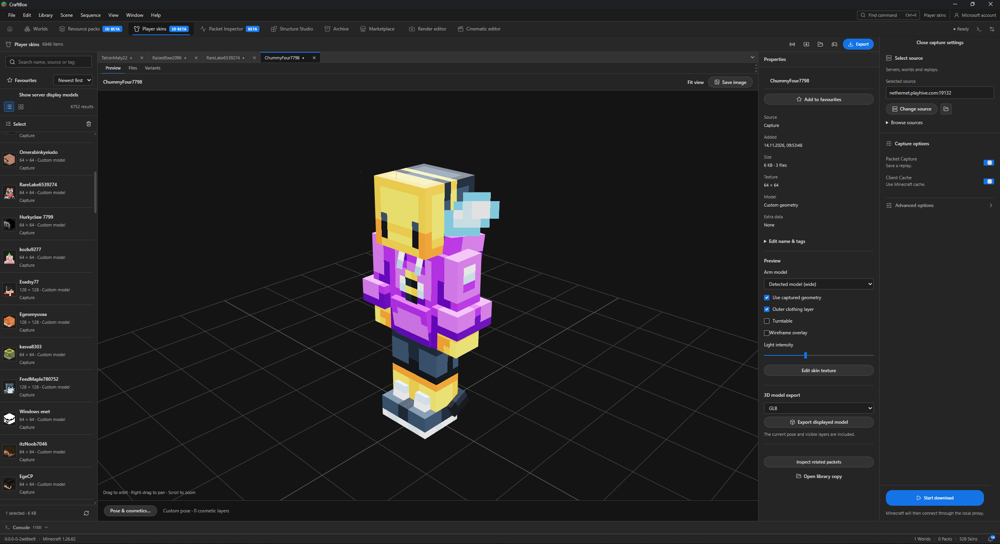
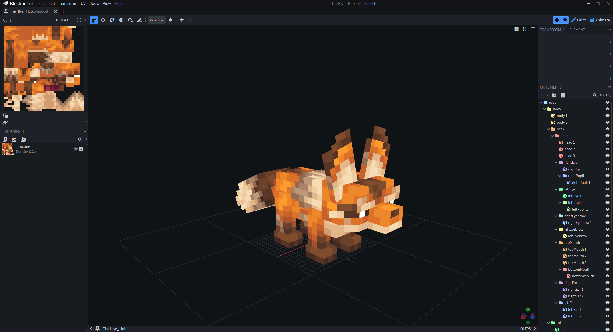
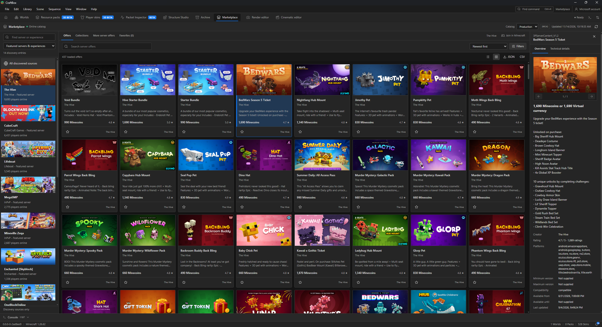

# CraftBox

CraftBox is a free, open source desktop app for Minecraft Bedrock, based on [bedrocktool](https://github.com/bedrock-tool/bedrocktool) and maintained by **SpindexGFX**. Capture a world while playing, save its resource packs and skins, then open the captured content for viewing, editing or export.

Alongside world capture, CraftBox includes a 3D viewer, Render and Cinematic editors, Structure Studio, and tools for inspecting packs, models and network packets. The command line and JavaScript capture hooks remain available. The [bedrocktool comparison](docs/bedrocktool-comparison.md) covers the differences, and the original project and its contributors are credited [below](#credits-and-license).

Download: [CraftBox releases](https://github.com/Daniel-Ric/CraftBox/releases) · [Documentation](#documentation) · [Report an issue](https://github.com/Daniel-Ric/CraftBox/issues)



*A Hive Games world in the Render editor, with lighting controls on the right.*

## Getting started

Download CraftBox from the [Releases page](https://github.com/Daniel-Ric/CraftBox/releases). The build workflow produces Windows and Linux desktop and command-line versions. Check the release notes for the Minecraft version supported by your build.

On Windows, launch the desktop executable. The desktop uses Microsoft Edge WebView2 Runtime. Keep CraftBox in a writable application folder so it can store its local data and restore bundled rendering assets. The interface is in English.

You can begin with a server capture, open an existing Bedrock world, or create a structure project. Rendering and structure editing do not require an active server connection.

### Capture a server world

1. Open **Worlds** and choose a source. CraftBox can resolve custom server addresses, Realms, friends' sessions, featured servers and supported Experiences.
2. Sign in to a Microsoft account when the selected source requires it. CraftBox displays the device-code sign-in instructions and keeps account selection in the desktop.
3. Choose the capture options you need, then start the session. Use the local connection address and port shown by CraftBox to join from Minecraft.
4. Explore the areas you want to save. The live map fills in as the server sends chunks to the client.
5. Stop the capture or leave the session to finish saving. Open the result folder to find the exported `.mcworld` and any enabled image or map-art outputs.

Each world visit is kept separately, including repeat visits with the same name. Dimension changes and server transfers can start another visit; `/save-world` saves the current terrain and starts a fresh capture without disconnecting. Visits with no received chunks do not create empty world archives.

Capture settings are remembered for each mode, and recent server addresses are available when choosing another source. Packet recording is enabled by default; keeping a recording lets you revisit supported capture workflows later.

### Open a local world

Open a Bedrock `.mcworld` archive or world folder in the Render or Cinematic editor to work with existing terrain. The editors also accept retained CraftBox captures and saved studio projects.

To transfer an installed singleplayer world, use **Copy singleplayer world** in the Worlds header. Close that world in Minecraft before exporting. CraftBox checks available resource-pack and add-on dependencies, then writes a new `.mcworld` without changing the original. Protected or missing content can still require the original files or account entitlement on the receiving device.

See [Copy a singleplayer world](docs/singleplayer-world-copy.md) for discovery, dependency checks and backup options.

## Worlds

World capture saves the chunk and block data delivered during play. Entity recording, custom entities, player models, inventories and block updates can be selected for the capture. Player and entity recording are off by default; inventory capture and the final map image are enabled by default in the world command.



*A saved world in the Worlds overview. From here you can open its output folder, export a world copy, create a render or start a camera sequence.*

Use the map to follow the player, add named markers and notes, or select a region to save separately. It can stay open in its own window while Minecraft is running.

The atlas also has height, biome and coverage overlays, coordinate lookup, distance and area measurements, and annotated PNG export. **Merge worlds** combines selected areas from several captures with position offsets and a preview of overlapping blocks. It saves a new world and keeps the source captures intact. The [atlas and composition guide](docs/map-atlas-and-composition.md) explains those tools.

### Terrain and dimensions

Choose **void**, **flat** or **normal** generation for terrain outside the captured area. The choice can also be changed during a session with `/generator <void|flat|normal>`; the existing `/void` command remains available.

Enable **Merge Dimensions** to collect later captures as custom dimensions inside the first saved world. The generated `/craftbox:dim` command lists the included worlds and lets a player travel between them. This workflow requires a Bedrock version that supports the generated custom dimensions and Script API modules; consult the release notes and the exported pack's requirements.

### Maps, entities and recorded interfaces

Captured item-frame maps can be exported as PNG tiles and assembled map walls. Top-down images use biome colors, water-depth shading and height-based lighting to make the terrain easier to read.

Supported entities can retain their equipment, while player exports use the available skin and model data. Custom visuals depend on the definitions and readable resource packs supplied during the session.

**Record Menus and Scoreboards** rebuilds captured forms, their recorded navigation links and scoreboard snapshots in an exported behavior pack. Item and entity interactions can reopen recorded forms. This preserves the recorded interface; server-side actions such as purchases, matchmaking and game logic are not recreated.

For capture behavior and pack requirements, see [World pack export](docs/world-pack-export.md). For markers, regions, exclusions and local capture controls, see [Ingame commands](docs/ingame-commands.md).

## Render editor

The **Render editor** turns a captured or imported world into an image. Orbit the scene or fly through it in first person, choose a look, then adjust the lighting, shadows, sky, water and colors. More than 100 looks are included as starting points. Each can be adjusted and saved as a preset.

There are cloud banks, placeable cloud regions, fog, HDR skies and point, spot and area lights. Automatic scene direction can suggest a camera and style from the loaded terrain. Depth of field, focus picking and a virtual world scale let you work on close-up or miniature-looking renders. Resource packs supply textures and supported custom block geometry; the texture inspector shows where a selected block face gets its appearance.

## Cinematic editor

The **Cinematic editor** adds camera keyframes, paths, shots and a timeline for arranging a sequence before exporting it. It shares the Render editor's scene settings, so a still image and a video can use the same lighting and atmosphere.

## Export formats

The export dialog offers:

- **Images and panoramas:** PNG, JPEG, WebP, TIFF and BMP, with transparency where the selected format supports it.
- **Static models:** GLB, glTF, OBJ, FBX and STL. GLB includes its textures in one file; multi-file formats are packaged together for transfer.
- **Cinematics:** MP4, WebM, MOV, MKV and GIF. Available video encoders depend on the desktop runtime.

Static model exports contain source geometry and materials. Camera animation, atmospheric effects and image postprocessing belong to the rendered image or video workflow. STL carries geometry only and does not guarantee a printable, watertight model.

See [Render and cinematic editors](docs/render-editor.md), [3D viewing and GLB export](docs/3d-viewer.md), and [Export formats](docs/export-studio.md) for controls, asset preparation and format-specific limits.

## Structure Studio

**Structure Studio** is an editor for Bedrock blueprints. Start with a blank structure, open a `.mcstructure`, or extract an area from a captured or local world. Each structure has its own tab and saved state.



*A fountain blueprint open in Structure Studio. The palette is on the left, selection and document properties are on the right, and the layer controls sit below the viewport.*

Build with a searchable block palette, place and remove individual blocks, fill or replace selections, and use copy, cut, paste, rotate, mirror and undo/redo. Named regions and the layer view make larger builds easier to navigate. Material lists can be exported, and blueprint comparison highlights missing, extra, different or incorrectly oriented blocks.

Blueprints can be exported as `.mcstructure`, saved as portable projects, or placed into a new Bedrock world copy. Ingame selection commands record the area you choose without editing the server's blocks. The translucent comparison preview is part of Structure Studio; an ingame building hologram is not currently implemented.

See [Structure Studio](docs/structure-studio.md) for editing, materials, comparison and world placement.

## Resource packs

The **Resource packs** and **Player skins** workspaces combine capture tools with local libraries. Import existing files, search and organize captured assets, add tags and favorites, and inspect duplicates or different versions.



*The Hive: Hub pack in the model preview. You can inspect its files, select a model and export it from the same workspace.*

Pack inspection includes file browsing, textures, supported block and entity model previews, and audio playback. Model tools provide selection, pose and geometry controls, along with export workflows for compatible external editors. Preview accuracy depends on the geometry, materials and texture bindings present in the source pack; unavailable bindings are identified rather than silently replaced with unrelated assets.

You can also export supported source models as editable Blockbench `.bbmodel` projects, with their bones, cubes, textures and supported animation data. This is separate from exporting a baked 3D preview. The [Asset Studio guide](docs/asset-studio.md) covers the supported formats and the parts of Minecraft's animation runtime that the preview cannot reproduce.

## Player skins

The skin preview uses captured custom geometry when it's available. You can switch the arm model, show or hide outer clothing, adjust the pose and inspect supported cosmetics. A player's saved appearance variants stay together, and the texture editor saves an edited skin as a separate library item.



*A captured player skin in the 3D preview, with its custom geometry enabled. The controls on the right include texture editing and model export.*

## Working with Blockbench

Choose **Blockbench project · Editable** to continue working on a captured model's bones, cubes, UVs and textures in [Blockbench](https://www.blockbench.net/). GLB and the other static model formats export the displayed geometry; `.bbmodel` export uses the available source model data.

1. Open a resource pack or player skin and select the model you want. If a model contains several objects, use **Extract model parts…** to choose the relevant parts.
2. In the model export controls, choose **Blockbench project · Editable**. Automatic format detection selects a suitable project type; you can also choose **Bedrock Entity**, **Bedrock Block** or **Generic Model** yourself.
3. Export the `.bbmodel` file and open it in Blockbench. The textures are embedded, so you don't need to collect the preview's texture files separately.



*An extracted Hive model open in Blockbench. Its texture is on the left and the editable bone and cube hierarchy is on the right.*

The exporter retains supported hierarchy, pivots, rotations, face UVs and material assignments. Available source animations and controllers can become editable data too. Some models need Generic Model because they use polygon meshes or several active textures. Minecraft runtime shaders, server-driven behavior and every Molang or controller playback feature cannot be reproduced in the editor. Information that wasn't included in the captured pack isn't available to export.

The [Asset Studio guide](docs/asset-studio.md#editable-blockbench-projects) has the format details and limits. Blockbench is a separate project by its own developers; exported Minecraft and server assets retain their original ownership.

## Audio Studio

Audio Studio opens pack sounds with waveform and multitrack previews. You can arrange clips and listen to them together while inspecting a pack. It currently works as a preview session; saving an audio project or exporting a mixed track is not implemented.

## Packet Inspector

**Packet Inspector** records and explores the NetherNet session shared with CraftBox's capture tools. Browse packet types, decoded fields and hexadecimal data, search a recording, inspect its timeline and replay it offline. Analysis views cover areas such as entities, movement, transactions and chunks. Intervention tools for edits, delays, blocking and explicit sends require a separate enabled mode.

Start a capture, open Packet Inspector and select its session to follow the traffic. Select a packet to see its decoded fields and bytes, then narrow the list with search and filters. Bookmarks and notes help keep track of a particular exchange. You can save useful parts as clips, compare sessions, and follow related skin or pack identifiers into the asset library.

Existing `.pcap2` recordings and supported ProxyPass logs or ProxyWeb JSON exports can also be imported. A text log has less information than a recording with packet bytes, and the inspector keeps that distinction visible. The [Packet Inspector guide](docs/packet-inspector.md) explains recording rules, playback, supported imports and the separately enabled intervention tools.

## Command Explorer and console

**Command Explorer** displays commands advertised by the connected server. The integrated console adds command completion, history and the `/cli` workflow. Session diagnostics retain useful context for connection errors and export failures, with a log viewer inside the application.

## Archive

**Archive** captures Minecraft data snapshots from supported installations and sources. Browse their files and decoded content, compare versions by files and identifiers, or inspect binary data and strings. Schema preparation, validation and previews for supported images and sounds are available in the same workspace.

## Marketplace

**Marketplace** shows online offers from supported featured-server and Experience sources, including item details, previews, favorites and comparisons. It needs a connection for catalog browsing; it does not keep an offline copy of the catalog.



*The online catalog with server discovery on the left, offers in the middle and the selected item's details on the right.*

See [Packet Inspector](docs/packet-inspector.md), [Console workspace](docs/console-workspace.md), [Persistent diagnostics](docs/persistent-diagnostics.md), and [Marketplace](docs/marketplace.md) for the individual workflows.

## Projects and files

These are the main files you'll come across:

- **`.mcworld`** imports a Bedrock world into Minecraft.
- **`.mcstructure`** transfers a Bedrock structure or blueprint.
- **`.craftbox`** preserves the document for a supported CraftBox studio workflow. Render and Cinematic projects include their scene data and editor settings; Structure Studio projects preserve their blueprint data and dependencies.
- **`.glb`** transfers a static textured model to compatible 3D applications.
- **`.pcap2`** records a proxy session for supported replay and inspection workflows.

Captured visits use separate identifiers, so repeated world names do not overwrite one another. Result-folder controls open the relevant output location. Saving an exported image or model is separate from saving the editable studio project.

CraftBox stores local settings, libraries, caches and diagnostics in its configured data locations. Keep account files and captures private when sharing a project folder: session data and diagnostic files may contain information about the account, server or connection.

See [Portable studio projects](docs/studio-projects.md) and [Document tabs](docs/document-tabs.md) for the saved-document behavior of each editor.

## Command line and scripting

The command-line interface uses the same capture handlers as the desktop. Run `help` to see the commands in your build, or pass `-h` after a command to inspect its options. The examples below use `Craft-Box.exe`; substitute the filename of your downloaded CLI build if it differs.

```powershell
.\Craft-Box.exe help
.\Craft-Box.exe worlds -h
.\Craft-Box.exe worlds -address=server.example:19132
.\Craft-Box.exe packs -address=server.example:19132
.\Craft-Box.exe list-realms
```

World capture options can be combined for a particular session:

```powershell
.\Craft-Box.exe worlds -address=server.example:19132 -generator=void -save-entities=true -map-art=true
.\Craft-Box.exe worlds -address=server.example:19132 -merge-dimensions=true -record-ui=true
```

A recorded world session can be processed without waiting for Minecraft to join. Use `-replay-join=true` when you want a client to join the replay.

```powershell
.\Craft-Box.exe worlds -address="C:/Captures/session.pcap2"
```

The top-down renderer accepts a world folder or a `.mcworld` archive and can select a dimension or export map art:

```powershell
.\Craft-Box.exe render -world="C:/Worlds/island.mcworld" -out="C:/Exports/island.png"
.\Craft-Box.exe render -world="C:/Worlds/island.mcworld" -dimension=nether -out="C:/Exports/nether.png"
.\Craft-Box.exe render -world="C:/Worlds/island.mcworld" -map-art=true -no-image=true -map-art-out="C:/Exports/maps"
```

The separate `render3d` command exports a world folder as GLB using a prepared asset catalog:

```powershell
.\Craft-Box.exe render3d -world="C:/Worlds/MyWorld" -assets="assets/vanilla-3d" -out="C:/Exports/world.glb"
```

JavaScript capture hooks can inspect packets and influence entity, block and chunk capture. The `PlayerAdd` hook can override the normal decision to save an individual player. Start with the [example script](scripting/example.js) and [type definitions](scripting/CraftBox.d.ts), then pass the script with `worlds -script="C:/Scripts/capture.js"`.

## Compatibility

This branch uses **NetherNet** for Minecraft connections. Both ends of the proxy must support the transport; the former RakNet transport is not available in this branch. The current source declares Minecraft **1.26.62**, protocol **2225**. Release notes describe the intended compatibility of each published binary.

Capture records the data actually sent to the client. Explore the areas you need: terrain that was never received and private server-side logic cannot be reconstructed. Custom blocks, entities and resource-pack appearances depend on the supplied assets and supported definitions. Some protected content may still require its original pack files or account entitlement.

Servers with strict anti-cheat may detect proxy behavior and flag or ban an account. CraftBox displays a sign-in notice about this risk. Use the tool in accordance with the server's rules and the permissions attached to the content you are working with.

If a connection fails, check the displayed endpoint, supported Minecraft version, transport and local firewall rules. If a world export is empty, confirm that Minecraft joined through CraftBox and the session received terrain. For missing visuals, review the resource-pack messages and available dependencies.

The [connection notes](docs/nethernet-migration.md) and [world export guide](docs/world-pack-export.md) describe known compatibility details. For a reproducible problem, [open an issue](https://github.com/Daniel-Ric/CraftBox/issues) with the build version, operating system, workflow, steps and relevant log excerpt. Remove account tokens and other credentials before sharing diagnostics.

<a id="craftbox-vs-bedrocktool"></a>

## Compared with bedrocktool

bedrocktool provides the proxy, world capture, pack and skin downloads, account sign-in, live map and command-line tools. CraftBox builds on that with the Render and Cinematic editors, Structure Studio, asset/model previews, editable Blockbench export, Packet Inspector, Archive, Marketplace and saved studio projects.

The [full comparison](docs/bedrocktool-comparison.md) lists both projects side by side, including shared functions, additions and current limits. Its source review is dated **14 November 2026**, against upstream commit `64c3e76` and CraftBox `2827663`, which includes the renderer fixes in this update. Check the release notes for what is included in a particular download.

## Developing CraftBox

The backend is written in Go. The desktop uses Wails, React and TypeScript, with Three.js for its 3D workspaces. Minecraft networking libraries are included as tracked snapshots in `third_party/`; Git submodule initialization is not required.

### Set up the repository

Install Git, Go **1.26.10** or a compatible toolchain, Node.js **22**, npm and Python **3.13** for the verified asset preparation workflow. Windows desktop users need WebView2 Runtime. Linux desktop development requires GTK 3 and WebKitGTK 4.1 development packages, including the platform's compiler and `pkg-config` tooling.

```powershell
git clone https://github.com/Daniel-Ric/CraftBox.git
cd CraftBox
go mod download
```

Desktop builds include a prepared vanilla rendering asset catalog. The same verified preparation used in CI downloads the pinned source assets, checks their hashes and creates the local catalog:

```powershell
python tools/prepare-ci-assets.py
```

The downloaded assets and generated bundle are excluded from Git. To prepare a catalog from local source files instead, follow [3D asset preparation](docs/3d-viewer.md).

### Build the desktop and CLI

From the repository root, select the platform and application types:

```powershell
go run ./build.go windows gui,cli
```

On Linux, with the native desktop dependencies installed:

```sh
go run ./build.go linux gui,cli
```

The build script installs frontend dependencies, builds the frontend, bundles prepared rendering assets and writes the binaries to `builds/`. It **regenerates the `builds/` directory**, so move any files you want to retain elsewhere first. A CLI-only build can use `go run ./build.go windows cli`.

Optional private extension sources are encrypted with git-crypt. Public builds work without unlocking them; available extension features depend on the build. Keep the bundled dependencies' license notices when redistributing or updating them.

### Work on the interface

The frontend has a browser preview for interface development:

```powershell
cd ui/desktop/frontend
npm ci
npm run dev
```

Open the address printed by Vite. Authentication, capture, native file dialogs and filesystem operations require the desktop backend and are not provided by the browser preview alone. See [Desktop UI development](docs/wails-ui.md) for the bridge, direct build commands and platform setup.

### Check changes

Run the frontend checks from `ui/desktop/frontend`:

```sh
npm test
npm run build
```

From the repository root, check the public Go packages used by the application:

```sh
go test ./cmd/CraftBox ./handlers/... ./internal/... ./subcommands ./ui/desktop ./ui/messages ./utils/... ./locale
```

For Windows desktop changes, also run `go test -tags gui ./ui/desktop`. On Linux, use `go test -tags gui,webkit2_41 ./ui/desktop` with the native dependencies installed. Select public packages explicitly while the private extension is locked; an unrestricted `go test ./...` also discovers its encrypted source directory.

## Documentation

The guides in `docs/` cover individual workflows and technical details:

- [Sources and connections](docs/source-browser.md), [account selection](docs/account-identity.md), and [NetherNet compatibility](docs/nethernet-migration.md).
- [Singleplayer world copies](docs/singleplayer-world-copy.md), [world pack export](docs/world-pack-export.md), [world regions](docs/world-region-editor.md), and [ingame commands](docs/ingame-commands.md).
- [3D viewer and GLB export](docs/3d-viewer.md), [Render and Cinematic editors](docs/render-editor.md), and [export formats](docs/export-studio.md).
- [Structure Studio](docs/structure-studio.md), [Asset Studio](docs/asset-studio.md), and [Marketplace](docs/marketplace.md).
- [Packet Inspector](docs/packet-inspector.md), [console workspace](docs/console-workspace.md), and [session diagnostics](docs/persistent-diagnostics.md).
- [Portable studio projects](docs/studio-projects.md), [document tabs](docs/document-tabs.md), and [preferences and updates](docs/preferences-and-updates.md).
- [Desktop development](docs/wails-ui.md) and the [bedrocktool comparison, with source revisions and review date](docs/bedrocktool-comparison.md).

## Contributing

Report bugs or suggest improvements through [GitHub Issues](https://github.com/Daniel-Ric/CraftBox/issues). Include your build version, the steps that caused the problem and what you expected to happen. Screenshots help with rendering and interface issues.

Pull requests are welcome. Describe what the change does and how it was checked. Keep the existing attribution and license notices, and check the relevant guide when changing capture, export or saved projects.

<a id="credits--attribution"></a>
<a id="license"></a>

## Credits and license

CraftBox is based on [bedrocktool](https://github.com/bedrock-tool/bedrocktool), originally developed by that project's contributors. Their work provides the foundation for the capture and proxy functionality in CraftBox.

CraftBox is maintained independently by **SpindexGFX**, with additional functionality, fixes and ongoing development. It is not officially affiliated with or endorsed by the original bedrocktool developers.

The original project is licensed under the **GNU General Public License v3.0 (GPL-3.0)**. CraftBox remains licensed under **GPL-3.0**; see [LICENSE](LICENSE). Bundled third-party components retain their respective license and attribution notices in [third_party](third_party/).

CraftBox is an independent project with no official relationship with Mojang AB or Microsoft Corporation. Minecraft and other third-party names, designs and assets belong to their respective owners.
